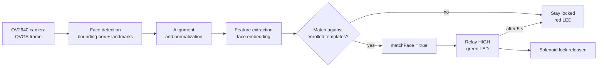
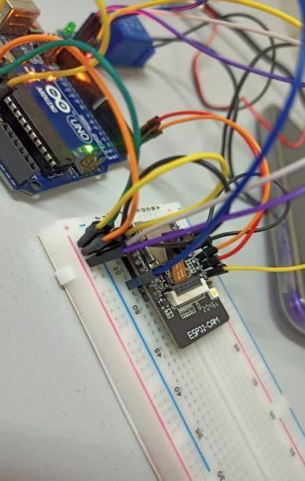
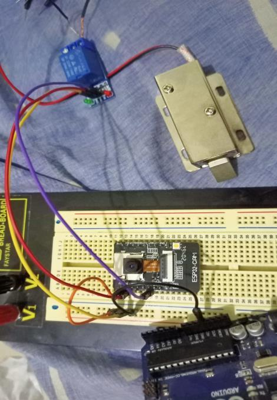

# Secure Access Control System Using Facial Recognition

A door lock that opens on a face. An ESP32-CAM detects and recognizes an enrolled subject entirely on-device, then drives a relay that releases a 12 V electromagnetic solenoid lock for five seconds before re-locking automatically.

No cloud service, no server: detection, feature extraction and matching all run on the ESP32's own processor, and the face templates stay in the module's flash.

-E7352C)
-00979D)


## Highlights

| | |
|---|---|
| Biometric mode | Identification (1-to-N) against the subjects enrolled on the module |
| Processing | Fully embedded: detection, 128-D embedding and matching run on the ESP32 |
| Camera | OV2640, streamed at QVGA (320 × 240) for recognition, UXGA buffers when PSRAM is present |
| Actuation | Relay module switching a 12 V / 1 A electromagnetic solenoid lock |
| Access logic | Unlock on match, hold 5 s, automatic re-lock, red/green LED state indication |
| Interface | Wi-Fi web interface served by the ESP32 (live stream, enrollment, sensor settings) |
| Programming | Arduino UNO used as a USB-to-serial bridge, since the ESP32-CAM has no USB connector |

## How it works

A biometric system always runs in three modes, and all three are visible in this project:

1. **Enrollment** — the subject stands in front of the camera and the face is sampled several times from the web interface. The library averages the samples into one template and stores it in flash as `Subject N`.
2. **Identification** — on every frame, a face is located, normalized, and converted into a feature vector. That vector is compared against every stored template; the closest one below the distance threshold wins.
3. **Actuation** — a match raises the `matchFace` flag, the main loop energizes the relay, and the solenoid releases the bolt.



Everything left of `matchFace` comes from the Espressif `CameraWebServer` example. Everything right of it is the access-control layer written for this project.

## Hardware

| Component | Role |
|---|---|
| ESP32-CAM (AI-Thinker, OV2640) | Captures the image, runs recognition, decides to open |
| Arduino UNO (ATmega328P) | USB-to-serial bridge for flashing, and 5 V supply for the module |
| Relay module (Keyes SRly, opto-isolated) | Lets a 3.3 V logic pin switch the 12 V lock |
| Electromagnetic solenoid lock | Holds the bolt; releases while energized |
| 12 V / 1 A DC adapter | Powers the lock side, galvanically separate from the logic |
| Red and green LEDs | Show the lock state at a glance |

### Wiring

Flashing mode (ESP32-CAM ↔ Arduino UNO used as a programmer):

| ESP32-CAM | Arduino UNO | Note |
|---|---|---|
| 5V | 5V | |
| GND | GND | |
| U0T (TX) | TX0 | straight, not crossed: the UNO's MCU is bypassed |
| U0R (RX) | RX0 | |
| — | RESET → GND | holds the ATmega328P in reset |
| IO0 → GND | — | remove this jumper after flashing |

Run mode (actuation side):

| ESP32-CAM | To |
|---|---|
| GPIO 2 | Relay `IN` |
| GPIO 12 | Green LED (through a series resistor) |
| GPIO 13 | Red LED (through a series resistor) |
| 5V / GND | Relay module `VCC` / `GND` |

The 12 V adapter feeds the solenoid lock through the relay's normally-open contact. The lock's 12 V never touches the ESP32: the relay is the only link between the two domains, which is exactly why it is there.





## The access-control logic

The recognition side of the firmware raises a flag; the main loop owns the door. Keeping the two apart means the unlock duration, the LED behaviour and the re-lock policy can be changed without touching the vision pipeline.

```cpp
void loop() {
  // a face was recognized and the door is currently locked -> unlock
  if (matchFace == true && activateRelay == false) {
    activateRelay = true;
    digitalWrite(Relay, HIGH);
    digitalWrite(Green, HIGH);
    digitalWrite(Red,   LOW);
    prevMillis = millis();
  }

  // the unlock window has elapsed -> lock again
  if (activateRelay == true && millis() - prevMillis > interval) {
    activateRelay = false;
    matchFace     = false;
    digitalWrite(Relay, LOW);
    digitalWrite(Green, LOW);
    digitalWrite(Red,   HIGH);
  }
}
```

The timer is non-blocking (`millis()` rather than `delay()`), so the camera keeps streaming and the web interface stays responsive while the door is open. The lock is driven `LOW` at the very start of `setup()`, so a reset or a brown-out leaves the door **closed** rather than open — a fail-secure default.

## Build and flash

1. In the Arduino IDE, add the ESP32 boards URL under **File → Preferences → Additional Board Manager URLs**:
   `https://dl.espressif.com/dl/package_esp32_index.json`
2. **Tools → Board Manager → ESP32 → Install**. This project was built with an ESP32 core version that still ships the face-recognition example (core 1.0.x); newer cores removed it.
3. Select **AI Thinker ESP32-CAM**, and make sure PSRAM is enabled.
4. Wire the module as in the flashing table above, with `IO0` jumped to `GND`.
5. Set `ssid` and `password` in `esp32cam_face_access.ino`, then upload.
6. Remove the `IO0`–`GND` jumper, open the Serial Monitor at **115200 baud**, press **RST**. The module prints the IP address it obtained.

## Running it

1. Open the printed IP address in a browser.
2. In the settings panel, enable **Face Detection**, then **Face Recognition**.
3. Click **Start Stream**, then **Enroll Face**. The sampling takes a few attempts to converge; once it does, the stream labels you `Subject 0`.
4. Step back in front of the camera. On a match the overlay greets the subject, the green LED lights, the relay clicks and the lock releases for five seconds.

## Results and limitations

The system works end to end, and that is the honest summary: a recognized face opens the door reliably under good, even lighting, facing the camera.

Where it falls short is worth stating plainly, because it is what the project actually taught me:

- **Image quality.** The OV2640 at QVGA, with no proper lens or illumination, is the bottleneck. Recognition degrades quickly with side lighting, backlighting, or a face more than about an arm's length away.
- **2D, therefore spoofable.** The pipeline sees a flat image. A printed photo or a phone screen held in front of the camera can pass. There is no liveness detection — no blink test, no depth, no infrared.
- **Capacity.** Only a handful of templates can be stored on the module (`FACE_ID_SAVE_NUMBER` in the face library), so this scales to a household, not to a building.
- **No transport security.** The web interface is plain HTTP on the local network, and enrollment is open to anyone who can reach that page. Anyone on the same Wi-Fi can enroll their own face.
- **Single factor.** A false accept opens a physical door. A real installation would pair the face with a second factor.

## Security and privacy

A face is not a password: it cannot be revoked, and the person cannot choose a new one after a leak. That shapes a few design points worth naming in any biometric project:

- The template stays **on the device**; no image and no embedding leaves the module. That is the main privacy property this architecture gets for free.
- The stored templates are feature vectors, not photographs, so a flash dump does not yield a usable picture — but it does yield material that identifies a person, and under the GDPR biometric data used to identify someone is a special category requiring explicit consent.
- Accuracy is not uniform across skin tones, ages and genders in published evaluations of face recognition, which matters the moment such a system guards access rather than suggests a photo tag.

## Repository structure

```
firmware/esp32cam_face_access/
  esp32cam_face_access.ino   camera init, Wi-Fi, access-control logic
  README.md                  companion files from the Espressif example
docs/
  Project-II-report.pdf      full report (biometrics, face recognition, build)
  images/                    hardware photographs
hardware/
  wiring.md                  pin-by-pin connections
```

## Roadmap

- [x] On-device detection, enrollment and recognition with relay-driven solenoid lock
- [ ] Liveness check (blink detection) to defeat printed-photo spoofing
- [ ] Second factor: keypad PIN or RFID tag alongside the face
- [ ] Access log with timestamps, written to the SD card slot
- [ ] Authentication on the web interface so enrollment is not open to the network

## Credits

The camera driver, the streaming server, the web interface and the face detection and recognition pipeline come from the **Espressif `CameraWebServer` example** (Apache-2.0), with the wiring and flashing procedure following the widely published ESP32-CAM face-recognition tutorials. The contribution of this project is the access-control layer: the relay and LED actuation, the non-blocking unlock timer, the fail-secure power-up state, and the hardware integration with the relay, solenoid lock and separate 12 V supply.

This was **Project II** at Óbuda University, Kandó Kálmán Faculty of Electrical Engineering, supervised by Varga Árpád.

## Author

**Ikhlass Kennich**, MSc student in Electronics, Electrical Energy and Automatic Control (E3A), Université Paris-Saclay.

## License

MIT for the code written for this project. The Espressif example files it builds on remain under Apache-2.0.
